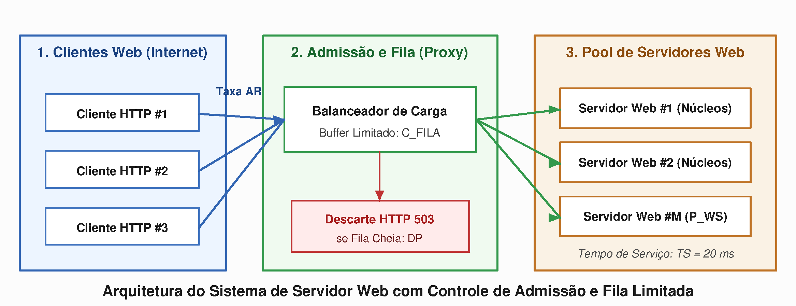
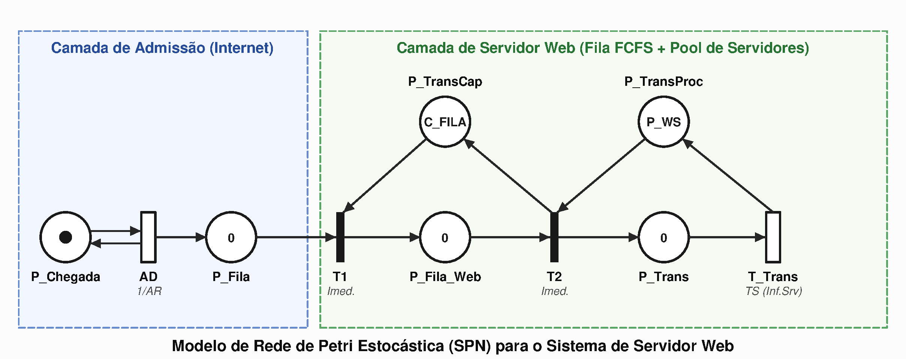

# Trabalho 07 - Modelagem e Avaliação de Desempenho com SPN

**Aluno:** Leonardo Virgulino Rodrigues Carvalho  
**Instituição:** Universidade Federal do Piauí (UFPI)  
**Contexto:** 1. Servidor Web (Requisições atendidas por servidores: como demanda e número de servidores afetam o desempenho?)

## Arquivos do Repositório

- `Trabalho07_SPN_Colab.ipynb`: Notebook com o cálculo das métricas do modelo SPN e geração dos gráficos dos experimentos E1 a E4.
- `modelo_servidor_web_jupiter.json`: Configuração do modelo SPN (lugares, transições, arcos, parâmetros e métricas) no formato do Jupiter Analytics.
- `run_experiments.py`: Script Python para execução dos experimentos E1, E2, E3 e E4 e exportação dos CSVs e figuras.
- `results/`: Tabelas em formato CSV com os resultados de cada bateria de testes (`E1_taxa_chegada.csv`, `E2_capacidade_processamento.csv`, `E3_capacidade_fila.csv`, `E4_cenarios_combinados.csv` e `tabela_consolidada.csv`).
- `figures/`: Diagramas e gráficos gerados para os experimentos.
- `artigo/`: Código-fonte LaTeX (`main.tex`) e figuras do artigo no formato IEEE.

## Modelo SPN e Métricas

### Arquitetura do Sistema


### Rede de Petri Estocástica (SPN)


| Métrica | Sigla | Unidade | Expressão no Modelo SPN |
| :--- | :---: | :---: | :--- |
| Utilização dos Servidores | `U` | `%` | `(E{#P_Trans} / P_WS) * 100` |
| Probabilidade de Descarte | `DP` | `%` | `P{(#P_Fila > 0) and (#P_TransCap == 0)} * 100` |
| Vazão (Throughput) | `TP` | `req/s` | `(E{#P_Trans} / TS) * 1000` |
| Tempo Médio de Resposta | `MRT` | `ms` | `((E{#P_Fila_Web} + E{#P_Trans}) * AD) / (1 - P{#P_TransCap == 0})` |
| Tempo Médio de Fila | `MQT` | `ms` | `(E{#P_Fila_Web} * AD) / (1 - P{#P_TransCap == 0})` |
| Tempo Médio de Processamento | `MPT` | `ms` | `(E{#P_Trans} * AD) / (1 - P{#P_TransCap == 0})` |

## Resultados Consolidados (TS = 20 ms)

| Cód. | Cenário | `AR` (req/ms) | `AD` (ms) | `P_WS` | `C_FILA` | `U` (%) | `TP` (req/s) | `MQT` (ms) | `MPT` (ms) | `MRT` (ms) | `DP` (%) |
| :---: | :--- | :---: | :---: | :---: | :---: | :---: | :---: | :---: | :---: | :---: | :---: |
| E1.1 | Demanda Baixa (100 req/s) | 0,10 | 10,00 | 8 | 20 | 25,00 | 100,00 | 0,00 | 20,00 | 20,00 | 0,00 |
| E1.2 | Demanda Moderada (250 req/s) | 0,25 | 4,00 | 8 | 20 | 62,50 | 250,00 | 1,11 | 20,00 | 21,11 | 0,00 |
| E1.3 | Demanda Nominal / Ref. (400 req/s) | 0,40 | 2,50 | 8 | 20 | 95,88 | 383,50 | 22,59 | 20,00 | 42,59 | 4,12 |
| E1.4 | Demanda Alta (550 req/s) | 0,55 | 1,82 | 8 | 20 | 99,98 | 399,93 | 43,37 | 20,00 | 63,37 | 27,29 |
| E1.5 | Demanda Extrema (700 req/s) | 0,70 | 1,43 | 8 | 20 | 100,00 | 400,00 | 46,67 | 20,00 | 66,67 | 42,86 |
| E2.1 | Config. A (4 núcleos) | 0,40 | 2,50 | 4 | 20 | 100,00 | 200,00 | 95,00 | 20,00 | 115,00 | 50,00 |
| E2.2 | Config. B (8 núcleos, Ref.) | 0,40 | 2,50 | 8 | 20 | 95,88 | 383,50 | 22,59 | 20,00 | 42,59 | 4,12 |
| E2.3 | Config. C (12 núcleos) | 0,40 | 2,50 | 12 | 20 | 66,67 | 399,99 | 0,70 | 20,00 | 20,70 | 0,00 |
| E3.1 | Fila Curta (`C_FILA = 10`) | 0,40 | 2,50 | 8 | 10 | 92,98 | 371,92 | 10,38 | 20,00 | 30,38 | 7,02 |
| E3.2 | Fila Média (`C_FILA = 20`, Ref.) | 0,40 | 2,50 | 8 | 20 | 95,88 | 383,50 | 22,59 | 20,00 | 42,59 | 4,12 |
| E3.3 | Fila Longa (`C_FILA = 40`) | 0,40 | 2,50 | 8 | 40 | 97,74 | 390,96 | 47,40 | 20,00 | 67,40 | 2,26 |
| E4.1 | C1: Subdimensionado | 0,55 | 1,82 | 6 | 10 | 99,97 | 299,92 | 29,36 | 20,00 | 49,36 | 45,47 |
| E4.2 | C2: Equilibrado (Recomendado) | 0,55 | 1,82 | 12 | 20 | 90,62 | 543,72 | 8,41 | 20,00 | 28,41 | 1,14 |
| E4.3 | C3: Superdimensionado | 0,55 | 1,82 | 16 | 40 | 68,75 | 550,00 | 0,46 | 20,00 | 20,46 | 0,00 |

## Execução

No Google Colab, basta abrir o arquivo `Trabalho07_SPN_Colab.ipynb` e executar todas as células. Para rodar via terminal:

```bash
python3 run_experiments.py
```
